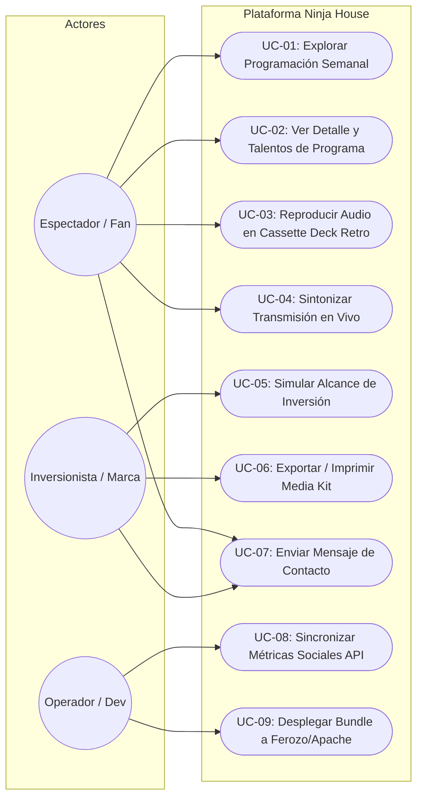
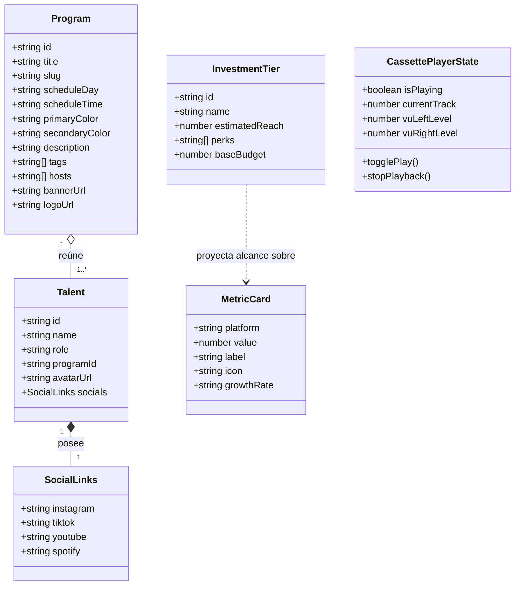
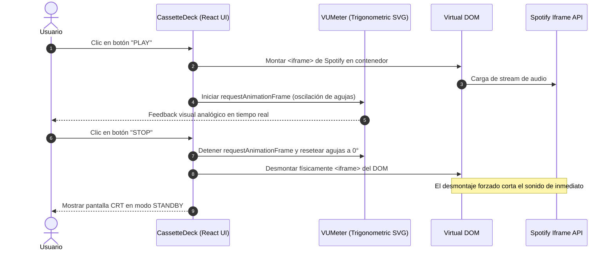
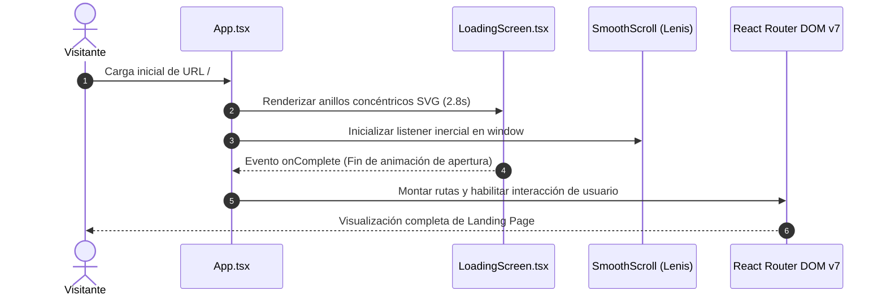
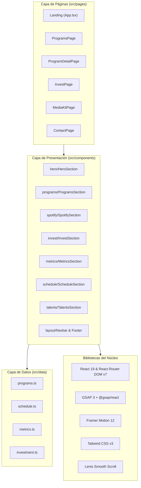
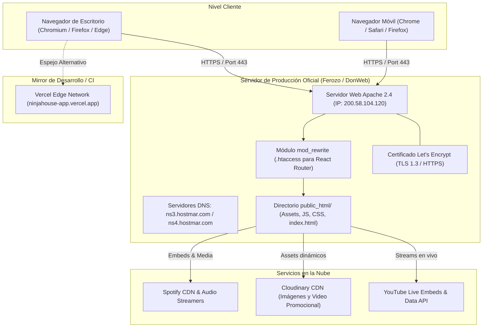

# 🏛️ Arquitectura del Sistema — Ninja House Web Platform

Este documento detalla la arquitectura de software de la plataforma **Ninja House**, basada en el estándar **RUP (Rational Unified Process)** y el modelo de **4+1 Vistas de Arquitectura de Philippe Kruchten**.

---

## 📑 Tabla de Contenidos
1. [Visión General del Sistema](#1-visión-general-del-sistema)
2. [Vista de Casos de Uso (Use Case View)](#2-vista-de-casos-de-uso-use-case-view)
3. [Vista Lógica (Logical View)](#3-vista-lógica-logical-view)
4. [Vista de Procesos (Process View)](#4-vista-de-procesos-process-view)
5. [Vista de Componentes (Component View / Implementation View)](#5-vista-de-componentes-component-view--implementation-view)
6. [Vista de Despliegue (Deployment View)](#6-vista-de-despliegue-deployment-view)
7. [Decisiones Arquitectónicas Clave (ADRs)](#7-decisiones-arquitectónicas-clave-adrs)

---

## 1. Visión General del Sistema

Ninja House es una Single Page Application (SPA) modular y reactiva orientada a la experiencia de usuario (UX/UI) de alta fidelidad, con estilo cyberpunk/geek neón y elementos retro-analógicos.

```
       +-------------------------------------------------------+
       |                  Cliente / Navegador                  |
       |     React 19 + TypeScript + Vite + Tailwind CSS      |
       +-------------------------------------------------------+
                                   |
         +-------------------------+-------------------------+
         |                                                   |
         v                                                   v
+------------------------+                        +--------------------+
|  Vercel Edge Network   |                        |  Ferozo / Apache   |
| (Mirror de Desarrollo) |                        | (Producción Oficial|
|                        |                        |  ninjahouseshow.com|
+------------------------+                        +--------------------+
         |                                                   |
         +-------------------------+-------------------------+
                                   |
                                   v
             +-------------------------------------------+
             |    Servicios Externos & CDNs              |
             |  - Spotify Embed API                      |
             |  - Cloudinary Media Asset Pipeline        |
             |  - YouTube Data & Embed Streams           |
             |  - Google Fonts CDN                       |
             +-------------------------------------------+
```

---

## 2. Vista de Casos de Uso (Use Case View)

La vista de casos de uso captura las funcionalidades centrales del sistema desde la perspectiva de los diferentes actores:

### Actores
1. **Espectador / Fan Geek**: Explora programación, mira transmisiones en vivo, reproduce música retro y sigue las redes de los talentos.
2. **Patrocinador / Marca Inversionista**: Analiza el impacto de audiencia, simula alcance publicitario por presupuesto y descarga el Media Kit.
3. **Desarrollador / Operador**: Mantiene datos estáticos, ejecuta scripts de sincronización de métricas sociales y despliega a producción.

### Diagrama de Casos de Uso RUP (UML)



---

## 3. Vista Lógica (Logical View)

Representa la estructura interna del código: clases, componentes, entidades de datos y hooks reactivos.

### Diagrama de Clases y Modelos de Dominio (UML)



### Jerarquía de Capas de la Aplicación

1. **Presentation Layer (Componentes UI y Páginas)**:
   - `src/pages/`: Páginas principales con Code-Splitting vía `React.lazy`.
   - `src/components/`: Componentes organizados por dominio funcional (`hero`, `programs`, `spotify`, `invest`, `metrics`, etc.).
   - `src/components/ui/`: Micro-componentes atómicos de diseño (`Button`, `Card`, `Badge`, `ScrollStack`).
2. **State & Orchestration Layer (Hooks y Contextos)**:
   - `useLenis`: Control de suavizado inercial del scroll de pantalla.
   - `useReducedMotion`: Accesibilidad y desactivación condicional de animaciones GSAP/Framer.
3. **Data / Domain Layer (Entidades Estáticas y Lib)**:
   - `src/data/`: Fuentes únicas de verdad inmutables (`programs.ts`, `schedule.ts`, `metrics.ts`, `investment.ts`).
   - `src/lib/`: Lógica de utilidades (formateadores, cálculo de horarios en vivo).

---

## 4. Vista de Procesos (Process View)

Muestra los flujos dinámicos, secuencias de interacción, concurrencia y gestión de estados asíncronos.

### 4.1 Flujo del Cassette Deck Retro (Gestión de Iframe y CORS)

Para silenciar inmediatamente el audio de Spotify sin incurrir en violaciones de política de mismo origen (CORS), el componente aplica desmontaje condicional en el ciclo de vida del DOM:



### 4.2 Flujo de Carga Inicial con Pantalla de Presentación



---

## 5. Vista de Componentes (Component View / Implementation View)

Organización física del código fuente y dependencias de compilación en paquetes:



---

## 6. Vista de Despliegue (Deployment View)

Representa la infraestructura física y de red donde se ejecuta la plataforma:



---

## 7. Decisiones Arquitectónicas Clave (ADRs)

| ID | Título | Decisión | Motivo / Justificación |
|---|---|---|---|
| **ADR-01** | Stack Frontend | React 19 + TypeScript + Vite | Tiempos de compilación menores a 2s, tipado estricto y soporte para las últimas APIs de concurrencia de React. |
| **ADR-02** | Rutas de SPA en Apache | Archivo `.htaccess` con `mod_rewrite` | Resuelve el clásico error 404 al recargar rutas profundas (`/programs`, `/contacto`) en hosting tradicional Ferozo/Apache. |
| **ADR-03** | Silenciado Inmediato de Audio | Desmontaje de Iframe Spotify | La API de Spotify en un iframe externo restringe el control de volumen por CORS; desmontar y montar el elemento garantiza pausa instantánea. |
| **ADR-04** | Medidores VU Analógicos | Animación SVG con trigonometría | Permite un barrido angular concéntrico exacto de la aguja sobre la escala sin distorsiones por transformaciones CSS básicas. |
| **ADR-05** | Media Kit Imprimible | Reglas CSS `@media print` | Evita generar dos aplicaciones distintas; un mismo componente renderiza vista web interactiva y vista corporativa limpia para PDF/impresión. |
